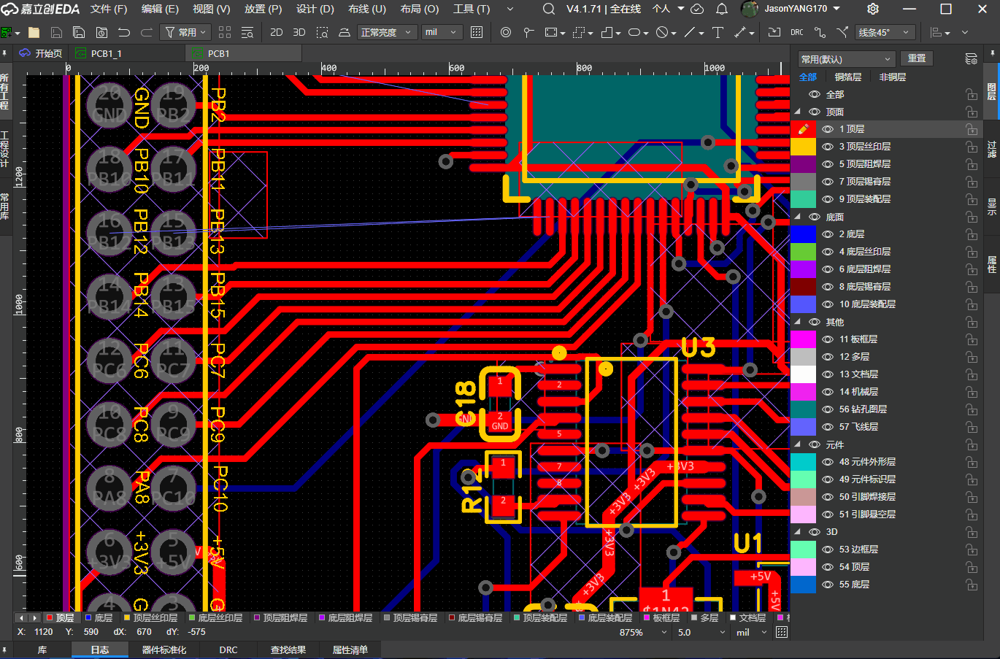
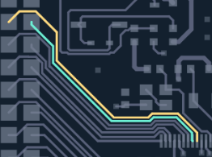
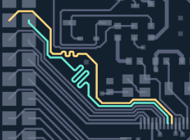
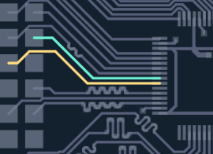
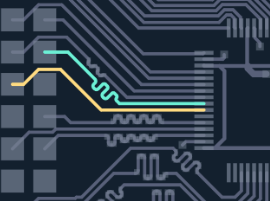

# 一键等长

用于嘉立创EDA专业版的 PCB 一键等长扩展。选择需要匹配的走线，设置目标长度，即可生成单边蛇形、双边蛇形、大折返或混合补长方案；支持动态振幅、自动推挤和多路联合重排。

## 演示

### 自动多线计算

可同时读取多条走线，以共同目标长度联合规划补长方案。插件根据各条路径的长度差和周围空间，分配蛇形位置与振幅，并协调目标走线的位置

| 等长前 | 等长后 |
| --- | --- |
|  |  |

### 自动障碍避让

插件会自动检查周围铜线及固定障碍，寻找可用的补长区段和展开方向

| 等长前 | 等长后 |
| --- | --- |
|  |  |

### 自动查找平衡

当被等长线以最长线为参考无法在有限空间避让时，插件会自动调整最长线位置后再调整被等长线

| 等长前 | 等长后 |
| --- | --- |
|  |  |

## 使用方法

1. 打开 PCB 文档，通过 一键等长 → 自动一键等长 打开面板。
2. 选择「完整走线」或「选中线段」，铜层默认「自动识别」。完整走线按识别出的路径总长处理，选中线段则将每个直线段作为独立目标。
3. 在画布选中走线后点击「读取选中」，或使用「两点取区」依次指定矩形的两个角。也可读取已有等长网络组或网络类。多次读取会累积目标，点击「清空」可重新选择。
4. 设置目标长度及顶部参数。多个目标可使用「自动匹配最长」；单条走线需要「指定长度」。
5. 点击「预览等长方案」，检查长度表、路径示意和状态提示，确认后点击「应用等长」。
6. 应用完成后查看实际长度误差；再次处理时重新读取目标。

## 参数说明

配置参数集中列在下方，均可在插件面板中调整。长度参数的默认单位为 mil，面板可切换为 mm；修改参数后，需要重新预览方案再应用。

| 参数 | 默认值 | 说明 |
| --- | --- | --- |
| 目标 | 自动匹配最长 | 将目标补齐到共同长度；也可手动指定。自动模式在部分 45° 重排场景中可能提高共同目标，最终值以预览提示为准。 |
| 间距 W | 20 mil | 相邻折返臂的中心线间距，须至少为目标最大线宽加避让净距。 |
| 最小振幅 H | 10 mil | 原走线中心线到峰顶的最小距离；双边峰谷总高度至少为 2H。 |
| 最大振幅 | 100 mil | 补长向外展开的振幅上限，不得小于最小振幅。 |
| 避让净距 | 6 mil | 用于规划时检查铜线及障碍间的间隙。 |
| 长度容差 | 0.1 mil | 允许的目标长度偏差，不得小于 0.001 mil。 |
| 波数 | 4 | 0 表示自动，范围为 0～48；双边蛇形至少 2 波，大折返不使用此参数。 |
| 等长方式 | 单边蛇形 | 可选单边蛇形、双边蛇形、大折返、混合模式。 |
| 动态振幅 | 开启 | 各折返独立分配振幅，并遵守最小、最大振幅。 |
| 方向 | 自动寻找两侧 | 也可限定为沿走线起点到终点的左侧或右侧。 |
| 避让模式 | 自动推挤 | 允许规划周围可移动走线的让位；选择「仅空位补长」时只利用现有空位。 |
| 差分模式 | 关闭 | 每次选择两个不同网络，且需存在同层、有足够重叠和间距的平行区段。 |